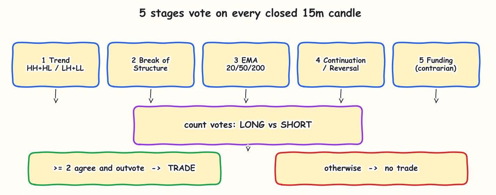
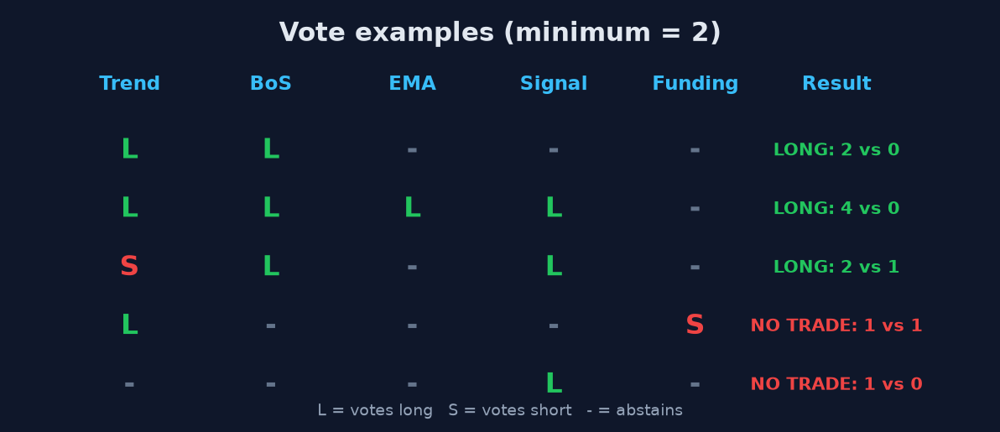
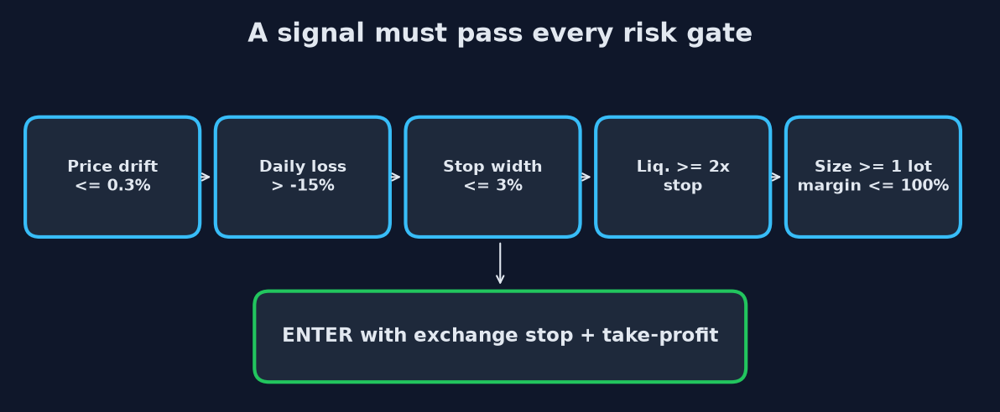

# 5-Stage BTCUSD Bot (Delta Exchange India)

Scans closed 15-minute BTCUSD candles with five stages. It opens **one trade at a time**, with a stop-loss and take-profit attached on the exchange, but **only when at least two stages agree**.

> **LIVE ONLY: this bot trades real money. There is no paper mode. You can lose everything you put in.**



## How it decides

| # | Stage | Votes |
|---|---|---|
| 1 | Trend | long in an uptrend (HH+HL), short in a downtrend (LH+LL) |
| 2 | Break of structure | direction of a close beyond a contact level on this bar |
| 3 | EMA 20/50/200 | long if close > EMA20 > EMA50 > EMA200 and rising, short for the mirror |
| 4 | Continuation / reversal | the full scanner signal on this bar |
| 5 | Funding (contrarian) | funding rank >= 0.90 (longs crowded) votes short; <= 0.10 votes long |

A trade needs `min_votes` (default **2**) stages on one side, with more votes than the other side. It fires only on the bar where that first becomes true, so a long-lasting trend does not re-enter every candle. If funding data is unavailable, funding simply abstains.



Stop and target come from the scanner's swing-based geometry (2R). With `target_equity_pct > 0` the target is replaced by a take-profit that nets that % of equity after fees.

## Read this first

- **Backtest (Jan-Oct 2026, 4-stage scanner, no leverage): +0.46% per trade, 48 trades, not statistically proven** (95% range -0.19% to +1.18%). The 2-of-5 vote rule and the funding stage have **not been backtested**.
- **The +20%-of-equity take-profit at 20x was replayed and lost money** (a 1.11% price move target against ~0.94% median stops). Set `"target_equity_pct": 0` to use the tested 2R target, and consider 5-10x.
- **Rare trades:** about 7 a month for the 4-stage version. A short run proves nothing.
- **Leverage is capped at 20x in code** (`MAX_LEVERAGE`). In the backtest 200x was liquidated on 94% of trades.
- If your PC sleeps, only the exchange's stop protects you; the software backup (flatten 0.2% past the stop) needs the bot running.
- With a tiny balance one lot may need more margin than you have, so every signal is skipped.

## Setup

```
pip install -r requirements.txt
python -m pytest -q
```

## Run (live)

1. Create a Delta live API key: Read + Trade, withdrawals OFF, IP-restricted if possible.
2. Set environment variables (never in a file): `DELTA_API_KEY`, `DELTA_API_SECRET`, `DELTA_LIVE_CONFIRM=I_ACCEPT_THE_RISK`.
3. `python bot.py selftest` (balance, position, price), then `python bot.py run`.
4. A file named `STOP` next to `bot.py` blocks new trades. **Delete it to let the bot trade.**
5. Keep the wallet small and turn Delta's auto top-up off.

| Command | What it does |
|---|---|
| `run` | trade live |
| `selftest` | check keys, signing, balance, position parsing |
| `status` | show saved state |
| `flatten` | close the position now |
| `reset-halt` | clear a halt after review |

Logs: `bot.log`. Closed trades: `trades.csv`.

## Settings (`config.json`, see `config.example.json`)

| Key | Default | Meaning |
|---|---|---|
| `leverage` | 10 | max 20 |
| `risk_per_trade_pct` | 8 | max loss at the stop, % of equity |
| `margin_use_pct` | 75 | max margin, % of equity |
| `target_equity_pct` | 20 | take-profit as % of equity (0 = scanner's 2R) |
| `min_votes` | 2 | stages that must agree (1-5) |
| `funding_hi` / `funding_lo` | 0.90 / 0.10 | funding rank thresholds for the vote |
| `funding_lookback_bars` / `funding_min_history` | 2880 / 500 | 30 days of 15m samples / minimum needed to vote |
| `daily_loss_limit_pct` | 15 | no new trades below this daily drawdown |
| `max_consecutive_losses` | 4 | then halt |
| `max_stop_pct` | 3 | skip wider setups |

## Safety rules (risk.py, tested)



| Rule | Default |
|---|---|
| Liquidation must be >= 2x farther than the stop | skip otherwise |
| Daily loss limit | -15% of the day's starting equity |
| 4 losses in a row | halt until `reset-halt` |
| Order timeout / unknown outcome | halt, never retry blindly |
| 5 API failures in a row | no new trades |
| A position the bot did not open | never touched |
| Kill switch | `STOP` file |

## Unverified (from Delta's docs, not a live test)

1. Signature is `method + timestamp + /v2/path + ?query + body`; `selftest` proves it.
2. Position `size` is signed (negative = short).
3. Wallet asset is `USD` (change `margin_asset` if selftest lists another).
4. Product fields `id`, `contract_value` (0.001), `tick_size` (0.5).
5. Bracket SL/TP is sent with the entry and exits as market orders (taker fees).
6. **Funding:** the `FUNDING:BTCUSD` candle symbol, its units and sign (positive = longs pay) are untested live.

Not modelled: funding payments while holding, news, trailing stops.

## Disclaimer

This software is provided "as is", without warranty of any kind. It is for educational and research purposes and is **not financial, investment, legal or tax advice**. Trading leveraged crypto derivatives carries a high risk of total loss, and past or backtested results do not predict future results. The author and contributors accept **no liability** for any loss, damage, missed trade, bug, exchange or API failure, or regulatory consequence arising from its use. You run it entirely at your own risk and are solely responsible for your API keys, your funds, and for complying with the laws, tax rules and exchange terms that apply to you, including whether trading crypto derivatives is permitted where you live. This project is not affiliated with or endorsed by Delta Exchange.

## Files

`bot.py` loop and CLI - `scanner.py` stages 1-4 and the vote - `funding.py` stage 5 - `risk.py` limits - `exchanges.py` Delta orders and data - `delta_client.py` API - `docs/make_images.py` regenerates the images.
